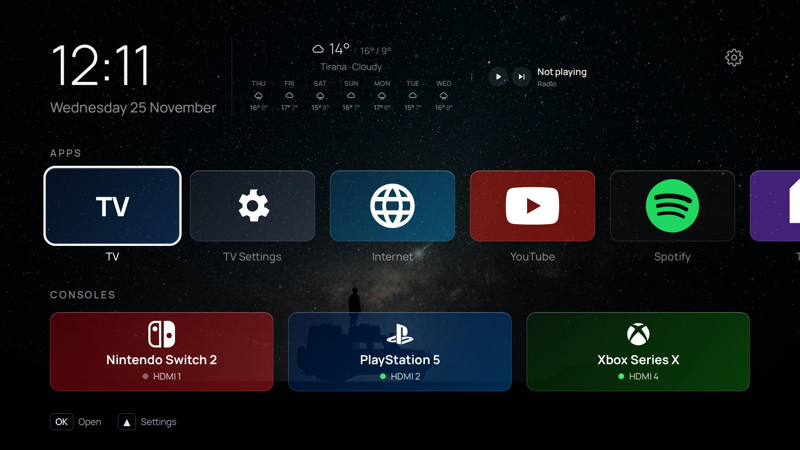
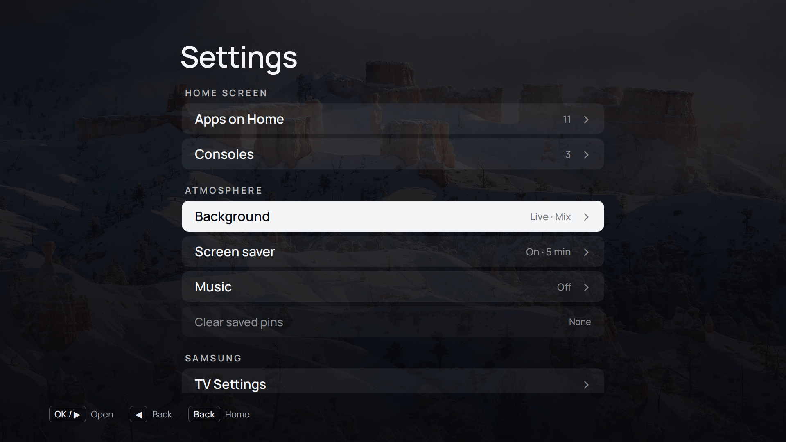
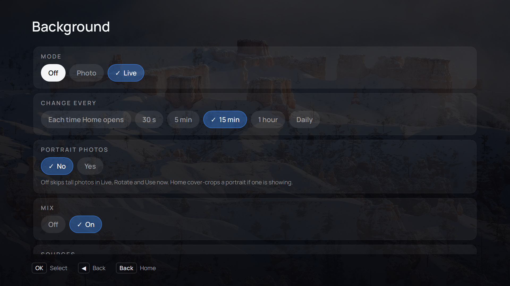
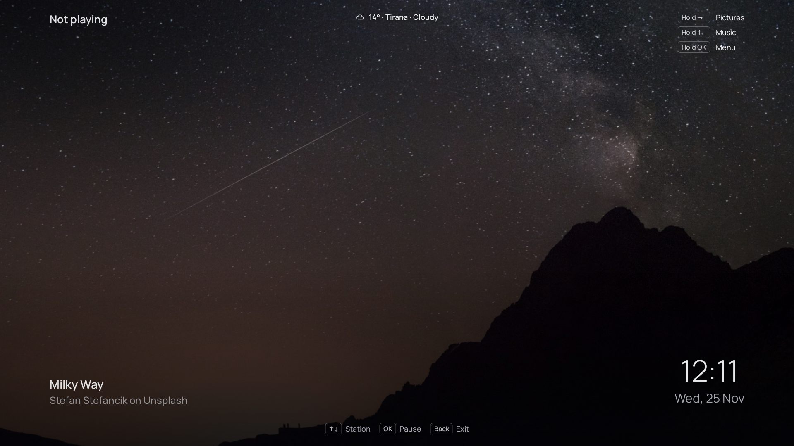

# Arn0+

A quieter home screen for Samsung Tizen TVs: clock, your apps, your consoles — plus live photos,
weather, curated radio, and optional Navidrome music.

Fork of [NelsonEU/arn0-tv](https://github.com/NelsonEU/arn0-tv). On the TV the label is **Arn0+**;
the app id stays `Arn0Lnchr0.Launcher` so Home / Vetro setup matches upstream.



| Settings | Live backgrounds | Screen saver |
| --- | --- | --- |
|  |  |  |

**Use at your own risk.** Making this the TV Home button changes undocumented settings. See
[docs/setup-tv.md](docs/setup-tv.md).

## Install on a TV

### Apps2Samsung catalog (recommended)

1. Install [Apps2Samsung](https://apps2samsung.com/) on your phone or computer
   ([GitHub](https://github.com/Apps2Samsung/Apps2Samsung))
2. Put the TV in **Developer Mode** and connect on the same network
3. In Apps2Samsung, open the catalog and install **Arn0+**
   (also listed in the [community packages](https://github.com/Apps2Samsung/tizen-community-packages) bundle)

Open **Arn0+** from the Samsung app list. No manual `.wgt` download needed for normal installs.

Optional: use [Vetro](https://github.com/andrearicci93/vetro) so the Home button opens this launcher.
Full Home / recovery notes: [docs/setup-tv.md](docs/setup-tv.md).

### Manual `.wgt` (updates / offline)

1. Download the latest **[release `.wgt`](https://github.com/dx616b/arn0-tv/releases/latest)**
2. Apps2Samsung → **Custom WGT** (signs on install)

## Features

- **Home** — clock, apps, HDMI consoles; normal remote
- **Live backgrounds** — Bing, NASA APOD, Wikimedia, Unsplash, Immich shared album, or **Mix**
  (Mix Mode Off = one source; On = multi-select roster)
- **Photo shelf** — pin Live stills, temporary “Use now”, hide bundled wallpapers
- **Weather** — current + week (Open-Meteo); auto-detect or search a city
- **Music** — curated online **Radio** (no server), or Navidrome / Subsonic (random / playlist)
- **Screen saver** — pan / portrait zoom, captions, weather, music; remote legend for source / photo / track

## Configure on the TV

Almost everything is in **Settings** (gear on Home):

| Area | What to set |
| --- | --- |
| **Atmosphere → Background** | Off / Photo / Rotate / Live; Mix Mode; sources; Unsplash key; Immich share link |
| **Weather** | Place (auto / search) and °C / °F |
| **Music** | Radio station or Subsonic server; play / next / volume |
| **Screen saver** | Delay, photo interval, go-dark |
| **Home / Consoles** | Tiles on Home, HDMI ports |
| **Appearance** | Clock, date, font, app name labels |

Optional build-time seed: copy `src/js/config.local.example.js` → `src/js/config.local.js`
(not committed). Most users can ignore this and use Settings on the TV.

## Develop

Needs Node.js 20+.

```sh
git clone https://github.com/dx616b/arn0-tv.git
cd arn0-tv
npm run preview        # http://localhost:8080
npm run build          # release .wgt (no local config / no devLogUrl)
npm run build:local    # sideload .wgt with config.local.js + Lab → PC logs
npm run devlog         # receive those logs on this machine (:8099)
```

`build:local` sets `devLogUrl` to the Windows LAN IP when built from WSL. Run
`npm run devlog` on **Windows** (firewall allow Node on :8099). Override with
`DEV_LOG_HOST` if needed. Arrow keys + Enter; Esc = Back.

Every push to `main` rebuilds a rolling prerelease; tag `v*` publishes a versioned `.wgt`.

## Thanks

- [NelsonEU](https://github.com/NelsonEU) — original Arn0 launcher
- [PatrickSt1991](https://github.com/PatrickSt1991) / [Apps2Samsung](https://apps2samsung.com/) — install & catalog
- [andrearicci93](https://github.com/andrearicci93) / [Vetro](https://github.com/andrearicci93/vetro) — Home remapping
- [SomaFM](https://somafm.com/) — listener radio streams (credited in-app)

MIT — see [LICENSE](LICENSE). Not affiliated with Samsung, Immich, Navidrome, SomaFM, Apps2Samsung, or Vetro.
